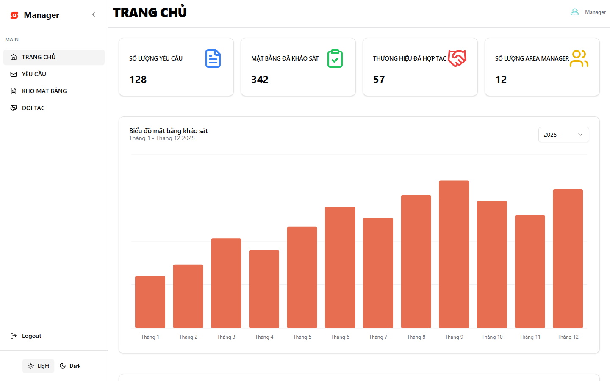
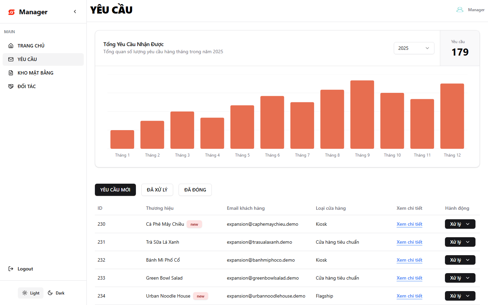
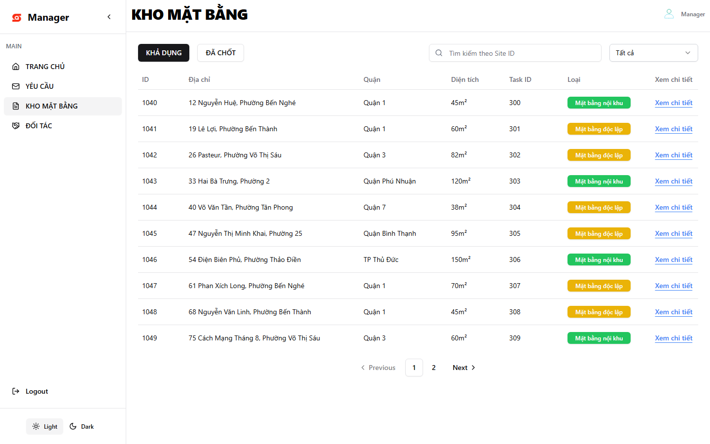

# SitePlus — web front end

Web front end of SitePlus, a platform that helps F&B and retail brands request site surveys and choose a location for a new store.

**Status:** Graduation project, FPT University, 2025 — archived. The backend is offline, so the live demo loads but cannot sign in or load data.

Related: [SitePlus-MB](https://github.com/Let-cal/SitePlus-MB) (Flutter app for field staff). The backend repository is private.

## Screenshots

Captured from a local build with mocked API responses (the backend is offline). All names and numbers in the images are sample data.

| | |
| --- | --- |
|  |  |
|  | |

## My role

Team Lead of a team of 5, and front-end developer. In this repository I built:

- **Sign-in and routing:** login page, auth context, JWT decoding and role-based protected routes.
- **Shared layout:** header, sidebar, light/dark theme toggle, navigation used by every role.
- **Brand (client) pages:** home page, about and contact pages, and the 4-step survey request form with brand selection and creation. Brands do not sign in; they hear back by email.
- **Admin pages:** dashboard with statistics and charts, user management (create and update users, assign area and district).
- **Manager brand tab:** brand table, brand detail and update dialog.
- **Deployment:** Vite build and routing fixes for Vercel.

The other manager and area-manager pages (dashboards, requests, tasks, site checks, matching, PDF export, email) were mainly built by [@giabao25](https://github.com/giabao25).

## Team

Team of 5. Commits in this repository: [@Let-cal](https://github.com/Let-cal) and [@giabao25](https://github.com/giabao25).

## Stack

React 18, TypeScript, Vite, Tailwind CSS, shadcn/ui (Radix UI), React Router, React Hook Form, Zod, Axios, Recharts, Chart.js, Leaflet.

## Features

- Public pages for brands (no sign-in) and signed-in pages for three roles: admin, manager, area manager. Field staff use the mobile app.
- Brands send a survey request in 4 steps; the manager accepts or declines it by email.
- Admin dashboard with request statistics; user management by area and district.
- Manager and area-manager pages for requests, survey tasks, sites and partner brands.
- "Search by AI" on a request (manager): the backend filters site deals by the brand's size, rent, lease and deposit ranges, then ranks them by similarity of Cohere embeddings stored in Qdrant. No language model generates text.
- Light and dark themes; Vietnamese interface.

## How to run

Requires Node.js 20.

```sh
npm ci
npm run dev        # development server
npm run build      # type check and production build
npm run preview    # serve the production build
```

The API base URL is hard-coded in `src/services/api-config.ts`. It points to the old Azure backend, which no longer exists.

## Known limitations

- The backend is offline, so sign-in and all data screens fail outside a mocked setup.
- No automated tests.
- The interface text is in Vietnamese only.
